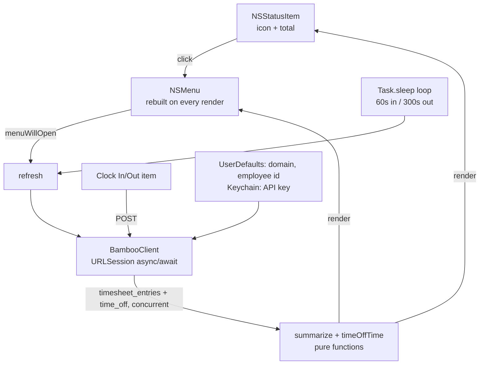

# BambooTime — implementation plan

Spec for (re)implementing this app. User-facing docs (install, setup, dev
commands) live in [README.md](README.md); don't duplicate them here.

> **Targets:** macOS 14+ · Swift 6 · AppKit `NSStatusItem` (no SwiftUI) ·
> SwiftPM only (no Xcode project) · API key auth · zero third-party
> dependencies · personal use (no notarization).
>
> **Requirements beyond the features:**
> - **Low resource use:** < 20 MB footprint, ~0% CPU idle, no network
>   traffic except the refresh triggers in §1. This drives the UI choice and
>   the resource rules in §4.
> - **Easy to package and update:** one script turns the repo into a
>   drag-to-install DMG (§7); updating = rebuild and replace, no updater code.


## 1. Behavior

```
Menu bar:   ● 4h 12m      (clocked in: circle.fill tinted green + today's total)
            ○ 3h 05m      (not clocked in: circle + today's total)
            ⚠             (error, no data yet: exclamationmark.triangle)
            ◌ / ⚙         (loading: circle.dotted / not configured: gearshape)
            │ click
            ▼
┌─────────────────────────────────────┐
│  Clock Out (in since 09:02)  ⌘K     │
│  ──────────────────────             │
│  09:02 – 11:30         2h 28m       │
│  11:45 – 13:00         1h 15m       │
│  13:10 – (live)           42m       │
│  ──────────────────────             │
│  Total today           4h 25m       │
│  ──────────────────────             │
│  Total this week      34h 50m       │
│  ──────────────────────             │
│  Refresh                      ⌘R    │
│  Open BambooHR                      │
│  ──────────────────────             │
│  Settings…                    ⌘,    │
│  Launch at Login              ✓     │
│  Quit                         ⌘Q    │
└─────────────────────────────────────┘
```

- **Label:** short (icon + total) because notched menu bars are cramped. Total
  in `monospacedDigitSystemFont` so the width doesn't jitter.
- **Top item:** `Clock Out (in since 09:02)` (the suffix in the info rows'
  font and `secondaryLabelColor`) or `Clock In`. While the POST runs:
  `Working…`, disabled. After the POST, refresh.
- **Info rows:** disabled items, `attributedTitle` with a right-aligned tab
  stop; the live row is green; `No entries today` when empty.
- **Week line:** `Total this week (excl. time off)` if time off couldn't be fetched.
- **Errors:** with stale data, a red `⚠ …` row under the top item; with no
  data, the error is the top row. Clock in/out and Launch at Login failures
  show an `NSAlert` (a menu row would go unseen; the menu closes on click).
- **401/403:** pause auto-refresh and show `Auto-refresh paused — check API key`
  (BambooHR disables API access after repeated bad keys). Menu open or Refresh
  still retries; success resumes.
- **Not configured:** `Not configured` row + Settings…, Launch at Login, Quit.
  Saving settings starts everything without a relaunch.
- **Refresh:** on launch, on menu open (render cached data first so live
  durations update, then refresh in place), after clock in/out, and in a loop:
  60s while clocked in, 300s otherwise.
- **Settings:** `NSAlert` with a domain field and an `NSSecureTextField`.
  Normalize the domain (`acme`, `acme.bamboohr.com` and a full URL all become
  `acme`), validate `[a-z0-9-]`, require a key, save the key to the Keychain;
  on failure re-show the dialog with a `⚠` message.
- **Launch at Login:** menu toggle via `SMAppService.mainApp`, checkmark from its status.

## 2. BambooHR API (verified against the live API)

Base URL `https://{companyDomain}.bamboohr.com/api/v1`. Basic auth with
username = API key and password = `x`. Send `Accept: application/json`
(some endpoints default to XML).

| Purpose | Endpoint | Facts |
| --- | --- | --- |
| Identify self | `GET /employees/0` | `0` = the key's owner; `id` may be a number or a string. Cache it (reset on settings save). |
| Clock + manual entries | `GET /time_tracking/timesheet_entries?start={day before week start}&end={tomorrow}&employeeIds={id}` | Flat, unpaginated array `{type: "clock"\|"hour", date, start, end, timezone, hours}`. Includes the **open** clock entry (`end: null`, `hours: null`). A future `end` is accepted; `start` must be within the last 365 days. Dates like `2026-11-06T07:43:00+00:00` (plain ISO 8601). Use this instead of `/time-tracking/clock-entries`, which has clock entries only. |
| Time off | `GET /time_off/requests?start={week start}&end={today}&employeeId={id}&status=approved&excludeNote=1` | `amount.unit` is `hours` or `days`; `dates` maps YYYY-MM-DD to the amount that day. Numbers may arrive as strings. `employeeId=0` is **not** supported (returns `[]`). |
| Hours per day | `GET /meta/time_off/types` | `defaultHours: [{name: "Monday", amount: "8"}, …]` (amount is a string). Fetch once; retry on later refreshes while it fails. |
| Clock in | `POST /time-tracking/clock-ins` `{"employeeId": 7, "timezone": "Europe/Berlin"}` | IANA `timezone` required (`TimeZone.current.identifier`). 409 if already clocked in. |
| Clock out | `POST /time-tracking/clock-outs` `{"employeeId": 7}` | 404/409 if not clocked in. |

Errors are JSON problem details (`detail`/`title`/`message`). Map 401, 403,
404, 409, 422 and 429 to a short explanation and append the server's detail.

**Prerequisites:** Time Tracking with clock in/out enabled (timesheet type
`CLOCK`), and an API user who can view and edit timesheets.

## 3. Calculation rules

- **Clocked in** = there's a `clock` entry with `end == null`; its `start` is "in since".
- **Duration:** clock entries `end − start` (or `now − start` while open);
  `hours` is rounded, so ignore it for clock entries. Hour entries use `hours`.
- **Today:** closed clock entries whose `date` equals today *in the entry's
  own timezone* (handles midnight when the Mac is elsewhere), plus the open
  entry. The open entry counts even if it started yesterday.
- **This week:** all non-open entries (clock and hour) whose `date` is between
  the week start (user's first weekday, gregorian, entry's timezone) and today,
  plus the open entry, plus time off. YYYY-MM-DD strings compare as plain strings.
- **Time off:** for each day from the week start through today: hour-based
  amounts as is; day-based amounts × `defaultHours` for that weekday (English
  name). That's how BambooHR's own weekly total counts it. Days after today
  don't count.
- **Formatting:** `42m`, `4h`, `4h 12m`; times via `Date.FormatStyle` (follows
  the user's 12/24h setting).

## 4. Architecture & decisions



- **AppKit `NSStatusItem` + `NSMenu`, not SwiftUI `MenuBarExtra`:**
  `menuWillOpen` is a reliable refresh hook, `attributedTitle` gives colored
  tab-stop rows, and it's the lightest UI (measured ≈15 MB footprint, 0% CPU idle).
- **Resource rules:**
  - Network only on the refresh triggers; no local ticking timer (the 60s
    refresh while clocked in keeps the label current, menu open re-renders
    live durations).
  - Timers only via `Task.sleep` (the OS coalesces them), never a spinning run loop.
  - No caches on disk (ephemeral `URLSession`). Fetch static data (employee id,
    hours per day) once.
  - The settings dialog is a transient `NSAlert`, not a window kept in memory.
- **No SwiftUI at all:** its macros don't compile with the Command Line Tools
  alone, and a two-field `NSAlert` is less code than a settings window.
- **Hidden Edit main menu** (Cut/Copy/Paste/Select All): an accessory app
  has no visible menu bar, but ⌘C/⌘V/⌘A in text fields only work if those items exist.
- **`LSUIElement` + `.accessory` activation policy:** no Dock icon. Call
  `NSApp.activate()` before showing any alert.
- **Refresh concurrency:** one `@MainActor` loop `Task`. A new refresh
  cancels the one in flight, so a refresh after clock in/out never gets
  overwritten by an older response. Ignore cancellation errors.
- **Entries and time off fetched concurrently** (`async let`); time off is
  best effort (`try?`), so a missing time-off permission never breaks clocking.
- **No sleep/wake observers:** `Task.sleep` runs on a continuous clock and
  fires on wake by itself; menu open refreshes anyway.
- **`URLSession`:** ephemeral (no disk cache), 10s request timeout. One generic
  `get(path, query)` decodes all GETs; `JSONDecoder` `.iso8601`; a `Flex`
  type decodes number-or-string values.
- **API key in the Keychain** (generic password, service = bundle id,
  account `api-key`), never in UserDefaults.
- **Not doing** (add only on demand): OAuth (needs a registered app on
  developers.bamboohr.com plus an embedded client secret, and the refresh
  token would still sit in the Keychain), notifications, configurable
  intervals, Sparkle, Homebrew, CI, notarization.

## 5. Files

```
Package.swift                 # macOS 14, executable target BambooTime + test target BambooTimeTests
Sources/BambooTime/
  main.swift                  # AppDelegate: status item, menu, refresh loop, actions; NSApplication bootstrap
  BambooClient.swift          # API client, BambooError, domain normalize/validate
  Status.swift                # TimesheetEntry, Summary, summarize, time off, date helpers, formatting, decoder
  Settings.swift              # Prefs (UserDefaults), Keychain, settings dialog
Tests/BambooTimeTests/
  StatusTests.swift           # Swift Testing, pure logic + live payload shapes
  LiveTests.swift             # real API; enabled only when BAMBOO_KEY is set
Support/Info.plist            # LSUIElement, CFBundleIdentifier me.thilo.bamboo-time, CFBundleIconFile, __VERSION__
Support/AppIcon.icns          # generated by scripts/make-icon.swift, checked in
scripts/bundle.sh             # build → .app → sign → DMG
scripts/make-icon.swift       # draws the icon, runs iconutil
```

## 6. Build order

1. Package + `Info.plist` + `main.swift` bootstrap; status item shows the gear.
2. Settings: Prefs, Keychain, dialog, domain normalization; Edit menu.
3. `BambooClient`: request helper, errors, `selfEmployeeId`, `timesheetEntries`.
4. `summarize` + formatting + unit tests (§3, §8).
5. Menu rendering and the refresh loop; clock in/out; Open BambooHR.
6. Time off + hours per day + week line; error/paused/not-configured states.
7. Launch at Login; `bundle.sh`; icon.

## 7. Packaging

- `scripts/bundle.sh VERSION`: set `DEVELOPER_DIR` to Xcode if installed (the
  Command Line Tools alone can't run SwiftPM's default build system or Swift
  Testing) → `swift build -c release` → `build/dmg/BambooTime.app` (binary,
  `Info.plist` with the version stamped in, icon in `Resources/`) →
  `codesign --force --sign "${SIGN_IDENTITY:--}"` (ad-hoc unless
  `SIGN_IDENTITY` is set in the environment or in the git-ignored `.env`,
  which the script sources if present) →
  `hdiutil create -format UDZO build/BambooTime.dmg` with an `Applications`
  symlink for drag-to-install; the symlink is removed from `build/dmg/`
  afterwards so editor file crawlers don't follow it into `/Applications`.
- Icon: white lowercase "b" whose bowl is a clock face (10:10) on a green
  rounded square (824 pt body on a 1024 grid), drawn with Core Graphics at all
  iconset sizes.

## 8. Verification

- **Unit tests:** empty day; closed + open today with yesterday excluded;
  open entry from yesterday; per-entry timezone at midnight; week total with
  manual entries; time off in hours and in days with a non-8h day; duration
  formatting; live payload shapes (closed, open, `Z` offset); domain normalization.
- **Live test** (`LiveTests.swift`): runs the real client and summing, prints
  the week's entries, and optionally asserts `BAMBOO_EXPECT_WEEK` against
  BambooHR's displayed weekly total. Reference: 47h 50m = 7h 50m clocked +
  5 vacation days × 8h.
- **App:** clock in → green label that ticks; clock out → total freezes;
  relaunch while clocked in → state restored from the API; sleep > 5 min and
  wake → one clean refresh; replace the app with a rebuilt one → settings and
  key survive; Launch at Login survives a logout.
- **Resources:** measure with `footprint -p $(pgrep -x BambooTime)`, not RSS
  (~80 MB, counts shared frameworks). Target < 20 MB, ~0% CPU idle.

## 9. Gotchas

- **Keychain + ad-hoc signing:** every rebuild has a new signature, so the
  first launch after an update asks for Keychain access. A stable self-signed
  identity (`SIGN_IDENTITY`) avoids it.
- **Launch at Login registers the app's path:** enable it from the copy in
  `/Applications`, not `build/`.
- **`swift run`:** an unbundled binary has no bundle id; test the Keychain and
  `SMAppService` from the `.app`.
- **Time off visibility:** an empty time-off result can also mean "no
  permission"; BambooHR returns `200 []` in that case.
